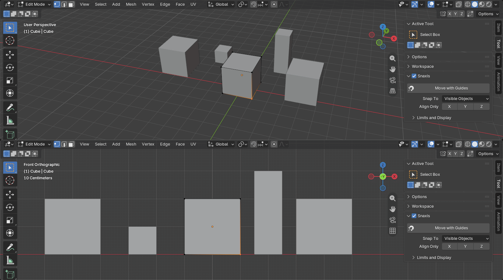

# Smart Clipping (Blender Addon)

[日本語](README.md)

## Overview

Smart Clipping is a Blender add-on that extends the move operation. While you move objects or vertices, it finds nearby elements as snap candidates and shows 3D guides and a HUD.

Near a candidate the selection is pulled toward it (soft snap); holding the right mouse button locks it onto the candidate (hard snap). Target Scope controls which meshes are searched.

The add-on is inspired by [Smart Guides](https://support.microsoft.com/en-us/office/guides-for-arranging-things-on-a-slide-33854dfa-e0d1-43ff-8971-667b19512de3) in Microsoft PowerPoint.

## Requirements

Blender 4.0 or later. Automated tests run on Blender 4.0, 4.2 LTS, and 5.2 LTS.

## Installation

1. Download `smart_clipping-vX.Y.Z.zip` from [Releases](https://github.com/marc2825/Blender_SmartClip/releases/latest).
2. In Preferences > Add-ons, choose the ZIP with Install from Disk (Install on Blender 4.1 and older).
3. Enable Smart Clipping.

### Upgrading from 1.1.x or earlier

Version 1.2.0 renamed the module from `src` to `smart_clipping`.

- Disable and remove the old version first. Enabling both makes their registrations collide.
- Add-on preferences start from their defaults again.
- Target Scope and Collection settings saved in `.blend` files carry over when the file is opened.

## Usage

The Smart Clipping panel is in the Tool tab of the 3D Viewport sidebar (N).

With Enable Smart Clipping on, press `Shift+G` in Object Mode or mesh Edit Mode, or click Smart Clipping Move in the panel, to start a move. With it off, `Shift+G` goes back to Blender's Select Grouped / Select Similar.

| Mode | What moves | What snaps |
|---|---|---|
| Object Mode | All selected objects (only the active one when Target Scope is Selected) | The active object's origin |
| Edit Mode | Selected vertices of the meshes being edited | The center of the selected vertices |

### Snapping

- Soft snap: close to a candidate, the selection is pulled toward it, more strongly the closer it gets.
- Hard snap: while the right mouse button is held, the selection sits exactly on the candidate.

The guide lines and the lower-left HUD show which object you are heading for and the distance.

After confirming, you can correct the move numerically as Offset in the Adjust Last Operation panel.

### Controls

| Input | Action |
|---|---|
| Left click / `Enter` | Confirm |
| `Esc` | Cancel and restore the original position |
| Hold right mouse button | Hard snap |
| `X` / `Y` / `Z` | Move along that axis only |
| `Shift+X` / `Shift+Y` / `Shift+Z` | Move in the plane excluding that axis |
| Middle mouse / wheel | Orbit, pan, or zoom without ending the move |

Press the same key again to release an axis or plane constraint. Constraints use the global axes; a constrained axis is drawn in red (X), green (Y), or blue (Z), and snapped positions stay on the constrained axis or plane.

### Snap targets

Target Scope in the panel selects which meshes can be snapped to.

| Target Scope | Snap targets |
|---|---|
| Self Only | The mesh being edited. Use it in Edit Mode to snap to other vertices of the same mesh |
| Selected | Selected meshes other than the active one |
| All Visible (default) | Every visible mesh |
| Manual Collection | Meshes in the chosen collection and its child collections |

### Axis Align

Turning on X, Y, or Z under Axis Align in the panel aligns to that axis's coordinate values instead of vertex positions.

With Z on, for example, a vertex at z = 1 offers z = 1 as a candidate while X and Y stay where they are. A dashed line leads to the vertex the value comes from.

- With several axes on, only one axis is aligned at a time.
- A value is a candidate only if the aligned position is within Snap Threshold on screen.
- An axis nearly parallel to the view direction, such as Z in top view, is skipped.

## Preferences

Set in Preferences > Add-ons > Smart Clipping.

| Setting | Default | Meaning |
|---|---|---|
| Snap Threshold (px) | 30 | Screen distance within which candidates are found |
| Max Vertex Budget | 50,000 | Maximum number of vertices registered as snap targets ([beyond the limit](docs/details.en.md#vertex-budget)) |
| Guide Color / Hard Snap Color | Magenta / cyan | Colors of the guides and HUD (the second during hard snap) |

Add Default Hotkeys and Clear Hotkeys on the same page restore or remove the `Shift+G` assignment.

## More information

- [How it works and troubleshooting](docs/details.en.md)
- [Changelog](CHANGELOG.md)
- [Developer guide](docs/DEVELOPMENT.md)
- Questions in [Discussions](https://github.com/marc2825/Blender_SmartClip/discussions), bug reports in [Issues](https://github.com/marc2825/Blender_SmartClip/issues) ([SUPPORT.md](SUPPORT.md))

## License

[MIT License](LICENSE)

## Development

This add-on was developed with [Claude Code](https://claude.com/product/claude-code) (Anthropic) and [Codex](https://openai.com/codex) (OpenAI).
