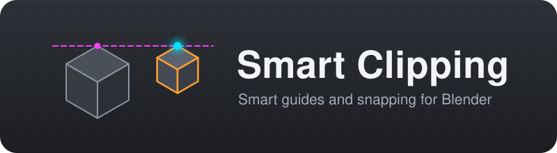
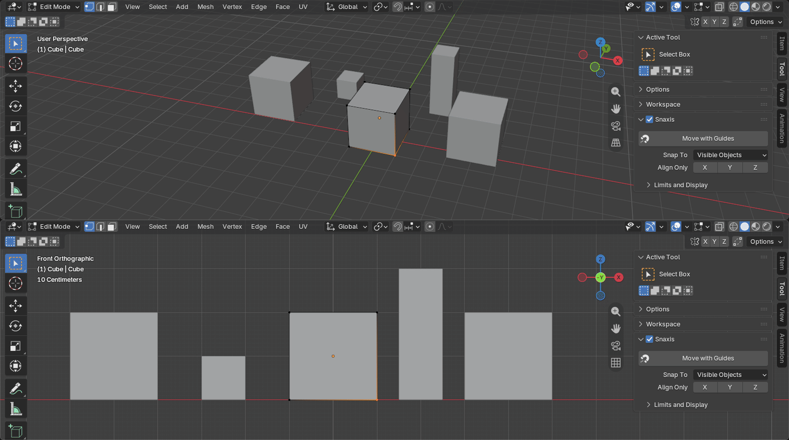

<!-- File: README.ja.md -->

  
  &nbsp;
  
  
  

  
  

**移動中に周囲の頂点へガイド線を表示し、直感的にスナップできる Blender アドオンです。** PowerPoint の[スマートガイド](https://support.microsoft.com/en-us/office/guides-for-arranging-things-on-a-slide-33854dfa-e0d1-43ff-8971-667b19512de3)のような操作感で、オブジェクトや頂点の位置を他の形状の頂点と素早く揃えられます。

## 主な機能

- **頂点へのスナップ**: 移動中の要素が周囲の頂点に近づくと、ガイド線を表示して正確な位置に吸着します。
- **単一軸の座標整列**: X・Y・Z のうち 1 軸の座標のみを、周囲の頂点と揃えられます。
- **軸・平面拘束との併用**: Blender 標準の移動操作と同様に、軸や平面に拘束したままスナップできます。
- **柔軟な対象切り替え**: オブジェクトモードと編集モードの両方に対応し、スナップ先（同じメッシュ / 選択したオブジェクト / 表示中のすべて / コレクション）を選択できます。日本語 UI にも対応しています。

## インストールと使い方

1. [Releases](https://github.com/marc2825/Blender_SmartClip/releases/latest) から、お使いの Blender に合う ZIP をダウンロードします（展開は不要です）。
   - Blender 4.2 以降: `smart_clipping-vX.Y.Z-extension.zip`（エクステンション）
   - Blender 4.0 / 4.1: `smart_clipping-vX.Y.Z.zip`（従来形式のアドオン）
2. **Preferences → Add-ons → Install from Disk**（4.1 以前は **Install**）から ZIP ファイルを選択し、有効化します。
3. オブジェクトまたは頂点を選択して `Shift+G` を押し、マウスで移動します。左クリックで確定、右クリックでキャンセルします。

## 移動中のキー操作

| キー | 動作 |
|---|---|
| 左クリック / `Enter` | 確定 |
| 右クリック / `Esc` | キャンセル |
| `Ctrl`（押している間） | スナップを一時無効化 |
| `X` `Y` `Z`（`Shift` 併用で平面） | 軸・平面に拘束 |
| `A` | 座標を揃える軸の切り替え（オフ → X → Y → Z） |
| `S` | スナップ先の切り替え |

実行中はステータスバーにも操作キーが表示されます。各種設定はサイドバー（`N`）の **ツール** タブ > **Smart Clipping** から変更できます。表示や設定の詳細は[操作ガイド](docs/details.md)を参照してください。

## 仕様・注意事項

- **ショートカットの割り当て**: `Shift+G` は Blender 標準の「グループで選択」「類似選択」の代わりに使用されます（標準機能はいずれも「選択」メニューから実行可能です）。キーはアドオン設定から変更・無効化できます。
- **スナップの基準点**: オブジェクトモードではアクティブオブジェクトの原点、編集モードでは選択頂点の中心が基準となります。
- **エクステンションと従来形式**: 同時に有効にできるのはどちらか一方だけで、後から有効にしようとした側は Blender が止めます。アドオンの設定と変更したショートカットは引き継がれません。切り替え方は[エクステンションか従来形式か](docs/details.md#エクステンションか従来形式か)を参照してください。
- **v1.x から更新する場合**: 右クリックがキャンセル動作に変更され、頂点へ自動で吸着する挙動が標準になりました。v1.x の「徐々に引き寄せる」挙動は **スナップのしかた** から選択できます。なお、v1.1.x 以前からは先に旧版（モジュール名 `src`）を削除してください。

## リンク

- [操作ガイド](docs/details.md)（[English](docs/details.en.md)） / [変更履歴](CHANGELOG.md) / [開発者向け資料](docs/DEVELOPMENT.md)（英語）
- 質問は [Discussions](https://github.com/marc2825/Blender_SmartClip/discussions)、不具合報告は [Issues](https://github.com/marc2825/Blender_SmartClip/issues) へお寄せください（[サポート](SUPPORT.md)）。脆弱性は [SECURITY.md](SECURITY.md) の手順に従い、非公開でご報告ください。

## ライセンス

[GPL-3.0-or-later](LICENSE) Copyright (c) 2026 marc2825

※ v2.0.2 までの版（正式頒布前）は MIT License で配布しています。

## 更新情報

- **2026年11月22日:** [MODELING HAPPY](https://modelinghappy.com/archives/71644) にて紹介されました！現在、正式頒布に向けた準備を進めています。
