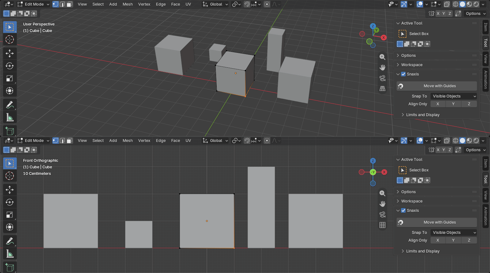

<!-- File: README.md -->

  
  &nbsp;
  
  
  

  
  

**A Blender add-on that shows guide lines to nearby vertices while you move, so that you can snap to them intuitively.** It works like [Smart Guides](https://support.microsoft.com/en-us/office/guides-for-arranging-things-on-a-slide-33854dfa-e0d1-43ff-8971-667b19512de3) in PowerPoint, letting you quickly line up objects and vertices with the vertices of other shapes.

## Key features

- **Snap to vertices**: when the moving element comes close to a nearby vertex, a guide line appears and it snaps to the exact position.
- **Align a single axis**: line up only the X, Y or Z coordinate with nearby vertices.
- **Works with axis and plane constraints**: as with Blender's own move, you can snap while constrained to an axis or a plane.
- **Flexible targets**: works in both Object Mode and Edit Mode, and you can choose what to snap to (the same mesh / selected objects / everything visible / a collection). The interface is also available in Japanese.

## Installation and usage

1. Download the ZIP for your Blender from [Releases](https://github.com/marc2825/Blender_SmartClip/releases/latest) (no need to unzip it):
   - Blender 4.2 or later: `smart_clipping-vX.Y.Z-extension.zip` (an extension)
   - Blender 4.0 / 4.1: `smart_clipping-vX.Y.Z.zip` (a legacy add-on)
2. Choose the ZIP under **Preferences → Add-ons → Install from Disk** (**Install** on 4.1 and older) and enable it.
3. Select an object or vertices, press `Shift+G` and move the mouse. Left click confirms, right click cancels.

## Keys during a move

| Key | Action |
|---|---|
| Left click / `Enter` | Confirm |
| Right click / `Esc` | Cancel |
| `Ctrl` (hold) | Turn snapping off temporarily |
| `X` `Y` `Z` (with `Shift`: plane) | Constrain to an axis or a plane |
| `A` | Switch the axis to align (off → X → Y → Z) |
| `S` | Switch what to snap to |

While a move runs, the status bar also shows these keys. Settings are in the sidebar (`N`) > **Tool** tab > **Smart Clipping**. See the [guide](docs/details.en.md) for what the viewport shows and every setting.

## Behavior and notes

- **Shortcut**: `Shift+G` is used instead of Blender's Select Grouped and Select Similar (both are still available from the Select menu). You can change or turn off the key in the add-on preferences.
- **Reference point**: what snaps is the active object's origin in Object Mode, and the median of the selected vertices in Edit Mode.
- **Extension and legacy add-on**: only one of them can be on at a time; Blender refuses to enable the second one. Settings in the add-on preferences and a changed shortcut do not carry over between them. See [Extension or legacy add-on](docs/details.en.md#extension-or-legacy-add-on) for switching.
- **Upgrading from v1.x**: right click now cancels, and snapping onto vertices automatically is the default. The gradual pull of v1.x is available as **Snap Behavior → Gradual Pull**. If you are upgrading from v1.1.x or earlier, remove the old version (module `src`) first.

## Links

- [Guide](docs/details.en.md) ([日本語](docs/details.md)) / [Changelog](CHANGELOG.md) / [Developer guide](docs/DEVELOPMENT.md)
- Ask questions in [Discussions](https://github.com/marc2825/Blender_SmartClip/discussions) and report bugs in [Issues](https://github.com/marc2825/Blender_SmartClip/issues) ([Support](SUPPORT.md)). Please report vulnerabilities privately, following [SECURITY.md](SECURITY.md).

## License

[GPL-3.0-or-later](LICENSE) Copyright (c) 2026 marc2825

Note: versions up to v2.0.2 (before the official distribution) were distributed under the MIT License.

## Updates

- **November 22, 2026:** Featured on [MODELING HAPPY](https://modelinghappy.com/archives/71644)! We are now preparing for the official distribution.
