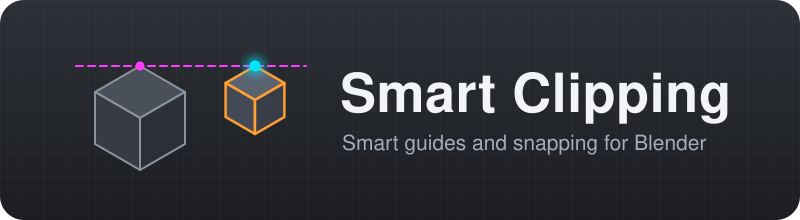

<p align="center">
  
  &nbsp;
  <a href="https://github.com/marc2825/Blender_SmartClip/releases/latest"></a>
  <a href="https://www.blender.org/"></a>
  <a href="LICENSE"></a>
</p>

<p align="center">
  <a href="README.md"></a>
  <a href="README.en.md"></a>
</p>

オブジェクトや頂点を移動するときに、近くの頂点へのガイド線を表示し、位置合わせ（スナップ）を手伝う Blender アドオンです。PowerPoint の[スマートガイド](https://support.microsoft.com/en-us/office/guides-for-arranging-things-on-a-slide-33854dfa-e0d1-43ff-8971-667b19512de3)を参考にしています。


> Blender 4.0 以降に対応しています。自動テストは Blender 4.0、4.2 LTS、5.2 LTS で実行しています。

## インストール

[Releases](https://github.com/marc2825/Blender_SmartClip/releases/latest) から `smart_clipping-vX.Y.Z.zip` を入手し、Blender の **Preferences → Add-ons → Install from Disk**（4.1 以前は **Install**）で読み込みます。ZIP は展開しないでください。

初期設定では、オブジェクトモードと編集モードの `Shift+G` を、Blender 標準の「グループで選択」と「類似選択」の代わりに使います。この 2 つはメニューの「選択」からも使えます。`Shift+G` で使い続けたいときは、アドオンの設定でキーを変えるか、**ショートカットを使う** をオフにしてください。

1.1.x 以前から更新するときは、先に旧版（モジュール名 `src`）を無効にして削除してください。両方を有効にすると登録が衝突します。アドオンの設定は初期値に戻りますが、`.blend` に保存したスナップ先などの設定は引き継がれます。

2.0 から、右クリックで移動を取り消すようになり、届く範囲の頂点にはボタンを押さなくてもぴったり合わせるようになりました。1.x の「徐々に引き寄せる」動きに戻すには、**スナップのしかた** を **徐々に引き寄せる** にしてください（サイドバーのパネル > 上限と表示、またはアドオンの設定）。

## 使い方

1. 3D ビューで N キーを押し、**ツール** タブの **Smart Clipping** パネルを開きます。
2. **スナップ先** でスナップするメッシュの範囲を選びます。初期値は表示中のすべてのメッシュ（可視オブジェクト）です。
3. オブジェクトモードかメッシュの編集モードで `Shift+G` を押し、移動を始めます。パネルや「オブジェクト」「メッシュ」メニュー > トランスフォームの **ガイド付きで移動** からも始められます。
4. 動かしている点が頂点に届く範囲（点線の円）に入ると、その頂点にぴったり合います。`Ctrl` を押している間はスナップしません。
5. 左クリックか `Enter` で確定し、右クリックか `Esc` で取り消します。確定後は **最後の操作を調整** パネルで移動量を数値で直せます。

移動中は `X` `Y` `Z` で軸に、`Shift` を付けると面に拘束できます。`A` で **座標合わせ**（頂点に重ねる代わりに、近くの頂点と座標だけをそろえる）を、`S` で **スナップ先** を切り替えられます。移動中はこれらのキーがステータスバーに表示されます。

画面は英語と日本語に対応しており、**プリファレンス → インターフェイス → 翻訳** の設定に従います。

操作キーの一覧、移動中の表示、設定項目は[操作ガイド](docs/details.md)にあります。

## 注意

- スナップ先は、ふだんはメッシュの頂点です。移動を始めた時点の形状（モディファイア適用後。編集中のメッシュは適用前）から作ります。
- 頂点に合わせるのは「動かしている点」です。オブジェクトモードではアクティブオブジェクトの原点、編集モードでは選択頂点の中心です。
- スナップ点の数は **スナップ点の上限**（初期値 50,000）までです。超えると、遠くのオブジェクトは頂点を間引くか、頂点の代わりにバウンディングボックスの角と原点（代理点）だけになり、代理点にもスナップします。さらに遠いものは対象外になります。
- 軸や面の拘束、位置のロック（Lock Location）などで頂点まで届かないときは、届く範囲でいちばん近い位置に動き、「投影」と表示します。
- パネル見出しのチェックボックスをオフにしたシーンでは、ショートカットのキー（初期設定は `Shift+G`）が Blender 本来の機能（`Shift+G` なら「グループで選択」「類似選択」）に戻ります。

## 関連文書

- [操作ガイド](docs/details.md)（[English](docs/details.en.md)）
- [変更履歴](CHANGELOG.md)
- [開発者向け資料](docs/DEVELOPMENT.md)（英語）
- [サポート](SUPPORT.md)：質問は [Discussions](https://github.com/marc2825/Blender_SmartClip/discussions)、不具合は [Issues](https://github.com/marc2825/Blender_SmartClip/issues) へ
- [セキュリティ](SECURITY.md)：脆弱性は公開の Issue ではなく非公開で報告してください

## 開発

Blender に同梱されたモジュールだけを使っています。テスト、CI、リリース手順は[開発者向け資料](docs/DEVELOPMENT.md)にあります。

```bash
blender --background --factory-startup --python tests/headless_test_runner.py  # テスト
python scripts/package_addon.py                                               # ZIP の作成
```

[Claude Code](https://claude.com/product/claude-code)（Anthropic）と [Codex](https://openai.com/codex)（OpenAI）を使って開発しました。

## ライセンス

[GPL-3.0-or-later](LICENSE) Copyright (c) 2026 marc2825

※ v2.0.2 までの版（正式頒布前）は MIT License で配布しています。

## 更新情報

- **2026年11月22日:** [MODELING HAPPY](https://modelinghappy.com/archives/71644) で紹介されました！ 頒布の準備を進めています。
